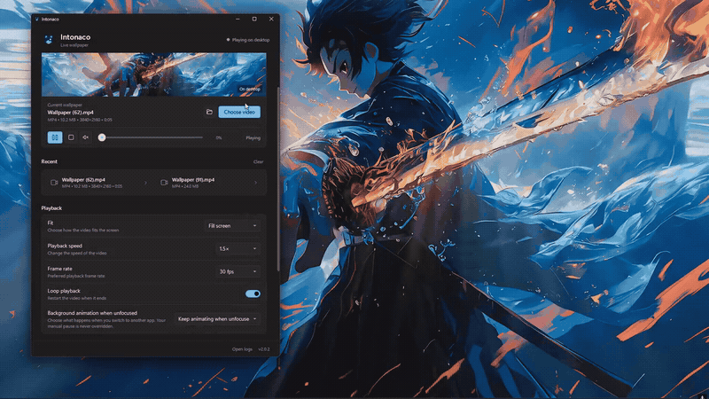

<p align="center">
  
  
</p>

[](https://github.com/77worldd/Intonaco/actions/workflows/ci.yml)
[](https://github.com/77worldd/Intonaco/releases)
[](LICENSE)
[](https://dotnet.microsoft.com/download/dotnet/8.0)

<p align="center">
  <a href="https://cdn.jsdelivr.net/gh/77worldd/Intonaco@main/docs/demo/intonaco-demo.mp4" title="Watch the full Intonaco demo with sound">
    <picture>
      <source media="(prefers-reduced-motion: reduce)" srcset="docs/demo/intonaco-demo-poster.png" />
      
    </picture>
  </a>
</p>

<p align="center">
  <a href="https://cdn.jsdelivr.net/gh/77worldd/Intonaco@main/docs/demo/intonaco-demo.mp4"><strong>&#9654; Watch the full 14-second demo with sound</strong></a>
  &nbsp;&middot;&nbsp;
  <a href="https://github.com/77worldd/Intonaco/raw/main/docs/demo/intonaco-demo.mp4">Download the MP4</a>
  <br />
  <sub>The preview plays right here on this page. One click opens the full recording in your browser's video player, with sound, seeking and full-screen controls.</sub>
</p>

**Lightweight live wallpaper for Windows 11**

Intonaco plays video files directly on your Windows desktop, behind your icons and below your windows. It uses Windows Media Foundation for native hardware-accelerated video decoding — no VLC, no embedded browsers, no heavy dependencies.


_Preview graphic rendered from the app's UI layout. Live screenshots are welcome via pull request — see [docs/VERIFICATION.md](docs/VERIFICATION.md)._

## Features

- **Real desktop integration** — Video plays behind desktop icons using the native Windows desktop layer
- **Hardware-accelerated playback** — Uses Windows Media Foundation with DXVA2 hardware decoding
- **Drag, drop and reuse** — Drop a video anywhere on the window, then bring favorites back from the recent-wallpaper list
- **Personalized playback** — Fill/Fit/Stretch modes, 0.5×–1.5× speed, looping, volume and frame-rate controls
- **Minimal footprint** — Single process, no background services; pausing stops the media clock with no new frames decoded or presented, and the preview decoder is closed whenever the main window is hidden
- **Pause without artefacts** — Pause keeps the last decoded frame on the very same MediaElement surface: no snapshot, no source close, no reopen, no black borders or blocks
- **Two background animation modes** — Choose *Pause when app loses focus* (default) or *Keep animating when unfocused*; the choice is saved and restored on restart, and never overrides a manual pause
- **Windows installer** — Optional per-user setup with Start Menu shortcut, optional desktop shortcut and clean uninstall; settings survive upgrades
- **Fullscreen-aware** — Additionally pauses when a borderless/fullscreen-exclusive app covers the monitor
- **Power-aware** — Pauses on sleep, lock, and display-off events
- **Explorer crash recovery** — Automatically reattaches after Explorer restarts
- **Silent boot** — Start with Windows writes the `HKCU\...\Run` value with `--minimized`, and Intonaco then starts straight into the tray with the last wallpaper already playing
- **System tray** — Runs quietly in the background with tray controls (Play/Pause, Choose video, Mute, Settings, Exit)
- **Clean Windows 11 UI** — Settings-style layout, Fluent dark/light surfaces (`#1E1E1E` window, `#272727` cards, `#60CDFF` accent used sparingly), native-sized controls and Segoe UI Variable typography
- **Light/Dark/System theme** — Follows the Windows app theme by default, or pick Light/Dark in Settings

## Supported Formats

Any video format supported by Windows Media Foundation:

- **MP4** (H.264, H.265/HEVC) — recommended
- **WMV**
- **AVI**
- **MOV**

> **Note:** the file picker also lists `.webm` and `.mkv` files, but Windows Media
> Foundation only plays them when matching codecs are installed. H.264 in an
> MP4 container works on every supported Windows version with no extra codecs.

For best performance, use H.264 MP4 files at your screen resolution or lower.

## System Requirements

- Windows 10 version 1903 or later / Windows 11
- .NET 8.0 Runtime ([download](https://dotnet.microsoft.com/download/dotnet/8.0)) — only for the **framework-dependent** download; the **installer**, portable EXE and self-contained zip need nothing
- Any GPU with DXVA2 support (integrated or discrete)

## Installation

### Installer (recommended)

Download `Intonaco-v2.0.0-win-x64-setup.exe` from
[Releases](https://github.com/77worldd/Intonaco/releases) and run it.
The installer:

- installs for the current Windows user, without administrator rights or
  a separate .NET installation;
- creates a Start Menu shortcut and offers an optional desktop shortcut;
- can launch Intonaco when setup finishes;
- appears in Windows Settings → Apps for normal uninstall;
- preserves `%LocalAppData%\Intonaco` settings and logs during upgrades,
  reinstalls and uninstall.

### Portable

If you prefer not to install, download the portable single file
`Intonaco-v2.0.0-win-x64.exe` and run it directly. Zip alternatives are:

- `Intonaco-v2.0.0-win-x64-self-contained.zip` — runs anywhere, no prerequisites
- `Intonaco-v2.0.0-win-x64-framework-dependent.zip` — tiny download, requires the .NET 8 Desktop Runtime

Optionally verify any download against the `SHA256SUMS.txt` published
with the release:

```powershell
Get-FileHash .\Intonaco-v2.0.0-win-x64-setup.exe -Algorithm SHA256
```

### Build from source

```powershell
git clone https://github.com/77worldd/Intonaco.git
cd Intonaco
.\build.ps1 -Publish
```

The published portable executable will be in the `publish/` folder.
To also build the Windows installer (requires Inno Setup 6, or
Chocolatey to install it):

```powershell
.\build.ps1 -Installer
```

The setup executable is written to `release/`.

Run the test suite with:

```powershell
dotnet test Intonaco.sln -c Release
```

## Usage

1. Launch Intonaco
2. Click **Choose Video**, or drag a video anywhere onto the window
3. The video immediately begins playing on your desktop
4. Tune **Fit**, **Playback speed**, volume and looping in Playback Settings
5. Minimize Intonaco to the system tray — it keeps running in the background

Videos you apply are kept under **Recent wallpapers** for one-click reuse.

### Controls

| Action            | Description                                   |
| ----------------- | --------------------------------------------- |
| Choose Video      | Select a video file as wallpaper              |
| Drag & drop       | Drop a supported video anywhere on the window |
| Recent wallpapers | Reapply one of your last six wallpapers       |
| ▶ / ❚❚            | Play, or pause the animation in place — the last frame stays visible, unchanged |
| ■                 | Stop wallpaper and restore default desktop    |
| Mute / volume     | Toggle or precisely adjust wallpaper audio    |
| Open location     | Show the current video in File Explorer       |

### Settings

| Setting             | Default | Description                                             |
| ------------------- | ------- | ------------------------------------------------------- |
| Wallpaper fit       | Fill    | Fill (crop), Fit (letterbox), or Stretch to the screen  |
| Playback speed      | 1.0×    | Slow dramatic loops to 0.5× or speed them up to 1.5×   |
| Frame rate          | 30 fps  | Preferred playback frame rate (throttled — 30 fps saves GPU vs 60 fps) |
| Loop playback       | On      | Restart the video when it reaches the end               |
| Background animation when unfocused | Pause when app loses focus | Two modes: pause animation updates on focus loss (default), or keep animating while another app is focused. Saved across restarts; a manual pause always wins. |
| Start with Windows  | Off     | Launch Intonaco at login (registry Run key with --minimized) |
| Start minimized     | Off     | Open Intonaco in the system tray on launch              |
| Resume last wallpaper | On    | Restore the previous wallpaper automatically on launch  |
| Theme               | System  | System (follow Windows), Light, or Dark appearance      |

Settings are stored in `%LocalAppData%\Intonaco\settings.json`. Run Intonaco with
`--minimized` to start hidden in the tray (used by the Start with Windows entry).

## Performance

Resource use depends strongly on the video's resolution/codec, display
size, GPU driver and whether the settings window is visible, so v2.0.0
does not repeat the old one-number RAM estimates. The important state
guarantees are architectural:

| State | Media work retained |
| --- | --- |
| Playing, settings window visible | Desktop decoder plus the separate live-preview decoder |
| Playing, app hidden in tray | **Desktop decoder only** — the preview source is closed |
| Paused | **Clock stopped** — the source and the last decoded frame stay on the same rendering surface; no new frames are decoded or presented |
| Focus/fullscreen/system pause | Same paused state: animation updates stop, rendering continues unchanged |
| Stopped/tray idle | No media source and no playback timers |

v2.0.0/2.0.1 tried to make Pause cheaper by photographing the `MediaElement`
into a bitmap, closing the Media Foundation source and showing that bitmap
instead. WPF MediaElement video lives on a native Media Foundation surface,
not in WPF's managed visual tree, so the snapshot was not a faithful copy of
the desktop — it baked black borders/blocks into the paused background, and
closing the source removed the only surface holding the real frame. v2.0.2
restores the v1 behaviour: Pause stops the media clock and keeps the exact
same rendering surface, geometry and last frame. FPS throttling
(`Timeline.DesiredFrameRate`), focus auto-pause and closing the *preview*
decoder while the window is hidden are all retained.

For a repeatable before/after sample on your own machine, play the same
video and run the following once while playing, again after pausing for
at least 10 seconds, and again with the app hidden in the tray:

```powershell
.\tools\Measure-IntonacoPerformance.ps1 -Label "Playing" -DurationSeconds 20
.\tools\Measure-IntonacoPerformance.ps1 -Label "Paused"  -DurationSeconds 20
```

Intonaco also logs before/after process snapshots around its one-off
paused-state collection to `%LocalAppData%\Intonaco\debug.log`. Compare
**PrivateMemoryMB** as well as Task Manager working set: Windows may
leave already-freed pages resident in the working set until memory
pressure reclaims them. On-device checks are tracked in
[docs/VERIFICATION.md](docs/VERIFICATION.md).

## Architecture

```text
Intonaco.exe (single process)
├── WPF UI (MainWindow)
│   └── Preview MediaElement → only while visible; paused in place when
│       the wallpaper pauses, closed when the window is hidden
├── PlayerWindow → classic WorkerW, or layered Progman child on raised desktops
│   └── MediaElement → Windows Media Foundation → DXVA2 (single, always-live
│       rendering surface; Pause stops only its media clock)
├── DesktopIntegration → layout detection, 0x052C split, verified placement
├── FullscreenDetector → 2-second polling only while playing or waiting
│   to resume from a fullscreen pause
└── SystemEventMonitor → sleep/wake/lock/display events
```

## Troubleshooting

### Video doesn't play

- Ensure the video codec is supported by Windows Media Foundation
- Install HEVC Video Extensions from Microsoft Store for H.265 files
- Try converting to H.264 MP4

### Wallpaper disappears after screen lock/sleep

- Intonaco automatically reattaches. If it doesn't, right-click the tray icon and select **Play**

### High CPU/GPU usage

- Minimize Intonaco to the tray while playing; that closes the second
  preview decoder and leaves only desktop playback running
- Pause when you do not need motion; Pause stops all animation updates
  while the last frame stays on screen (no capture, close or reopen)
- Use a lower-resolution video
- Ensure hardware acceleration is working (use the H.264 codec)

> Frame-rate throttling is implemented via `Timeline.DesiredFrameRate` and a
> `CompositionTarget.Rendering` guard; lowering from 60 fps to 30 fps reduces
> composition GPU work measurably.

### Desktop icons missing

- This can happen if Intonaco fails to find the correct WorkerW window
- Restart Explorer: open Task Manager → find Windows Explorer → Restart

### Status says "Playing" but the desktop doesn't change

Windows 11 24H2 and newer (including 26H2 Insider builds) use a "raised
desktop": the wallpaper is a WorkerW child of Progman under a layered icon
view. Intonaco v1.0.3+ requests that WorkerW layer when it is absent,
guards the WPF player's `WS_EX_LAYERED` style against WPF removing it,
and verifies the final layered placement before reporting success. If the
desktop still doesn't change:

- Make sure **desktop icons are shown** (right-click desktop → View → Show
  desktop icons) — some early 24H2 builds hid live wallpapers otherwise
- Use **Open logs** in the footer and attach `debug.log` to an issue — it
  records the detected desktop layout, Progman's child z-order and placement
  checks

### "Failed to attach to desktop"

Intonaco logs every attach attempt to `%LocalAppData%\Intonaco\debug.log`
(press `Win+R`, paste the path, Enter). If applying a wallpaper still fails
after restarting Explorer, please open an issue and attach that file — it
lists the exact desktop windows found on your Windows build.

### Something crashed

Unhandled errors are appended to `%LocalAppData%\Intonaco\crash.log` — please
attach that file when opening an issue.

## Development

| Command (Windows, .NET 8 SDK)                                  | Result                                  |
| -------------------------------------------------------------- | --------------------------------------- |
| `dotnet build Intonaco.sln -c Release`                         | Builds app + tests                      |
| `dotnet test Intonaco.sln -c Release`                          | Runs the xUnit test suite               |
| `.\build.ps1 -Publish`                                         | Publishes `publish\Intonaco.exe`        |
| `.\build.ps1 -Installer`                                       | Builds the Inno Setup installer in `release\` |
| `.\tools\Measure-IntonacoPerformance.ps1`                      | Samples process RAM/CPU for a labelled state |
| `python tools/generate-icon.py`                                | Rebuilds app icons and light/dark brand lockups from `docs/branding/` |

Every push is built and tested on Windows by GitHub Actions, including
the media-lifecycle tests and a silent installer install/launch/
reinstall/uninstall smoke test
([.github/workflows/ci.yml](.github/workflows/ci.yml)); version tags (`v*`)
additionally publish the official GitHub release
([.github/workflows/release.yml](.github/workflows/release.yml)).

## License

This project is licensed under the [MIT License](LICENSE).

## Acknowledgments

Intonaco uses the WorkerW desktop integration technique documented by the Windows development community. Video playback is handled entirely by Windows Media Foundation.

- Hardcodet.NotifyIcon.Wpf — System tray integration (MIT License)
- The desktop-integration Intonaco is an independent creation.
