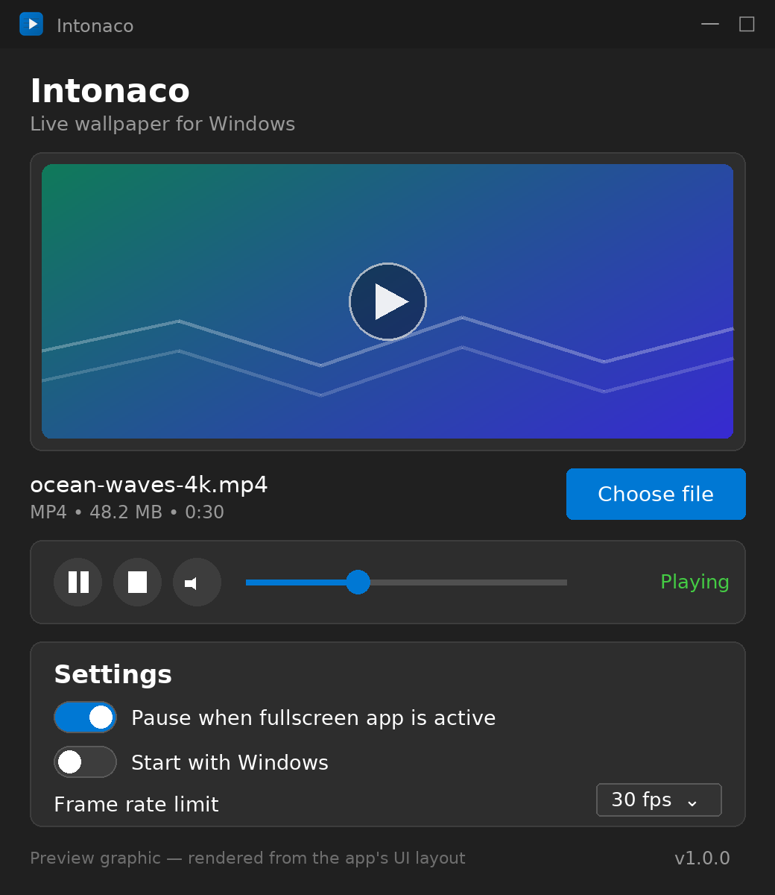

# Intonaco

[](https://github.com/77worldd/Intonaco/actions/workflows/ci.yml)
[](https://github.com/77worldd/Intonaco/releases)
[](LICENSE)
[](https://dotnet.microsoft.com/download/dotnet/8.0)

**Lightweight live wallpaper for Windows 11**

Intonaco plays video files directly on your Windows desktop, behind your icons and below your windows. It uses Windows Media Foundation for native hardware-accelerated video decoding — no VLC, no embedded browsers, no heavy dependencies.



_Preview graphic rendered from the app's UI layout. Live screenshots are welcome via pull request — see [docs/VERIFICATION.md](docs/VERIFICATION.md)._

## Features

- **Real desktop integration** — Video plays behind desktop icons using the native Windows desktop layer
- **Hardware-accelerated playback** — Uses Windows Media Foundation with DXVA2 hardware decoding
- **Minimal footprint** — Single process, no background services, ~15–25 MB RAM during playback
- **Fullscreen-aware** — Automatically pauses when games or fullscreen apps are running
- **Power-aware** — Pauses on sleep, lock, and display-off events
- **Explorer crash recovery** — Automatically reattaches after Explorer restarts
- **System tray** — Runs quietly in the background with tray controls
- **Clean Windows 11 UI** — Dark theme, Segoe UI Variable, native-feeling controls
- **Light/Dark/System theme** — Follows the Windows app theme by default, or pick Light/Dark in Settings

## Supported Formats

Any video format supported by Windows Media Foundation:

- **MP4** (H.264, H.265/HEVC) — recommended
- **WMV**
- **AVI**
- **MOV**

> **Note:** the file picker also lists `.webm` and `.mkv` files, but Windows Media
> Foundation only plays them when matching codecs are installed. H.264 in an
> MP4 container works on every supported Windows version with no extra codecs.

For best performance, use H.264 MP4 files at your screen resolution or lower.

## System Requirements

- Windows 10 version 1903 or later / Windows 11
- .NET 8.0 Runtime ([download](https://dotnet.microsoft.com/download/dotnet/8.0)) — only for the **framework-dependent** download; the **self-contained** download needs nothing
- Any GPU with DXVA2 support (integrated or discrete)

## Installation

### Portable (recommended)

1. Download a zip from [Releases](https://github.com/77worldd/Intonaco/releases):
   - `Intonaco-v1.0.0-win-x64-self-contained.zip` — runs anywhere, no prerequisites (≈60–80 MB)
   - `Intonaco-v1.0.0-win-x64-framework-dependent.zip` — tiny download, requires the .NET 8 Desktop Runtime
2. Extract to any folder
3. Run `Intonaco.exe`

Optionally verify your download against the `SHA256SUMS.txt` published with the release:

```powershell
Get-FileHash .\Intonaco-v1.0.0-win-x64-self-contained.zip -Algorithm SHA256
```

### Build from source

```powershell
git clone https://github.com/77worldd/Intonaco.git
cd Intonaco
.\build.ps1 -Publish
```

The published executable will be in the `publish/` folder.

Run the test suite with:

```powershell
dotnet test Intonaco.sln -c Release
```

## Usage

1. Launch Intonaco
2. Click **Choose file** and select a video
3. The video immediately begins playing on your desktop
4. Minimize Intonaco to the system tray — it keeps running in the background

### Controls

| Action          | Description                              |
| --------------- | ---------------------------------------- |
| Choose file     | Select a video file as wallpaper         |
| ▶ / ⏸           | Play or pause the wallpaper              |
| ⏹               | Stop wallpaper and restore default desktop |
| 🔇 / 🔊          | Toggle audio (muted by default)          |
| Volume slider   | Adjust wallpaper audio volume            |

### Settings

| Setting             | Default | Description                                        |
| ------------------- | ------- | -------------------------------------------------- |
| Pause on fullscreen | On      | Pauses playback when a fullscreen app is active    |
| Start with Windows  | Off     | Launch Intonaco at login (minimized to tray)       |
| Frame rate limit    | 30 fps  | Limits playback frame rate to save resources       |
| Theme               | System  | System (follow Windows), Light, or Dark appearance |

Settings are stored in `%LocalAppData%\Intonaco\settings.json`. Run Intonaco with
`--minimized` to start hidden in the tray (used by the Start with Windows entry).

## Performance

Intonaco is designed for minimal resource usage:

| State                  | RAM       | CPU   | GPU   |
| ---------------------- | --------- | ----- | ----- |
| Idle (tray)            | ~12 MB    | 0%    | 0%    |
| Playing 1080p 30fps    | ~20–30 MB | 1–3%  | 2–5%  |
| Paused                 | ~15 MB    | 0%    | 0%    |
| Fullscreen app active  | ~15 MB    | <0.1% | 0%    |

Estimates based on Windows 11 23H2, Intel i7-12700K, integrated UHD 770. Actual
values depend on video resolution, codec, and hardware. Community measurements
are tracked in [docs/VERIFICATION.md](docs/VERIFICATION.md).

## Architecture

```text
Intonaco.exe (single process)
├── WPF UI (MainWindow)
├── PlayerWindow → parented to WorkerW desktop layer
│   └── MediaElement → Windows Media Foundation → DXVA2
├── DesktopIntegration → WorkerW technique
├── FullscreenDetector → 2-second polling (low overhead)
└── SystemEventMonitor → sleep/wake/lock/display events
```

## Troubleshooting

### Video doesn't play

- Ensure the video codec is supported by Windows Media Foundation
- Install HEVC Video Extensions from Microsoft Store for H.265 files
- Try converting to H.264 MP4

### Wallpaper disappears after screen lock/sleep

- Intonaco automatically reattaches. If it doesn't, right-click the tray icon and select **Play**

### High CPU usage

- Lower the frame rate limit to 15 or 24 fps
- Use a lower-resolution video
- Ensure hardware acceleration is working (use H.264 codec)

### Desktop icons missing

- This can happen if Intonaco fails to find the correct WorkerW window
- Restart Explorer: open Task Manager → find Windows Explorer → Restart

### Something crashed

Unhandled errors are appended to `%LocalAppData%\Intonaco\crash.log` — please
attach that file when opening an issue.

## Development

| Command (Windows, .NET 8 SDK)                                  | Result                                  |
| -------------------------------------------------------------- | --------------------------------------- |
| `dotnet build Intonaco.sln -c Release`                         | Builds app + tests                      |
| `dotnet test Intonaco.sln -c Release`                          | Runs the xUnit test suite               |
| `.\build.ps1 -Publish`                                         | Publishes `publish\Intonaco.exe`        |
| `python tools/generate-icon.py`                                | Regenerates `intonaco.ico` / `.png`     |

Every push is built and tested on Windows by GitHub Actions
([.github/workflows/ci.yml](.github/workflows/ci.yml)); version tags (`v*`)
additionally publish the official GitHub release
([.github/workflows/release.yml](.github/workflows/release.yml)).

## License

This project is licensed under the [MIT License](LICENSE).

## Acknowledgments

Intonaco uses the WorkerW desktop integration technique documented by the Windows development community. Video playback is handled entirely by Windows Media Foundation.

- Hardcodet.NotifyIcon.Wpf — System tray integration (MIT License)
- The desktop-integration approach was informed by studying [AutoWall](https://github.com/SegoCode/AutoWall) (GPL-3.0); Intonaco is an independent reimplementation. See [THIRD-PARTY-NOTICES.md](THIRD-PARTY-NOTICES.md).
